# The Consequences of Falling Fertility — and What Can Be Done About It

A companion report to `report.md` (World Population, Birth Rates, and Long-Term Projections). Where the main report establishes *what* is happening to global fertility, this report analyzes *what follows*: the economic, fiscal, and social consequences of sub-replacement fertility, the policy responses now running at national scale, and the honest counterarguments to demographic alarmism.

**Scope and method note.** This synthesis draws on (1) UN World Population Prospects 2024 and Our World in Data datasets already processed in `data/processed/`, (2) an academic-evidence review of 14 peer-reviewed papers ( summarized in `population_aging_research_report.md`), and (3) structured research on Japan, Korea, China, Europe, and pro-natal policy design. Figures sourced directly from official statistics (UN, OECD, Eurostat, national agencies) are labeled with their source; a small number of figures come from general knowledge and are flagged **[verify]** before quotation in formal work. Charts below reuse the same `charts/` assets as the main report.

---

## 1. Executive summary

- Global fertility has fallen from **~4.85 children per woman (1950) to ~2.3 today**; the UN projects **~1.8 by 2100**, and IHME/Lancet modelers project **~1.59 by 2100** — both far below replacement (~2.1).
- The consequences are already visible: **more than half the world's population lives in countries below replacement fertility**, and roughly **two-thirds of countries (including 80%+ of high-income ones)** are under 2.1.
- Economically, sustained fertility decline produces slower workforce growth, faster population aging, and — depending on the study — measurable growth drag. The academic evidence spans **demographic dividend accounting** (Bloom & Williamson 1998: roughly one-third of East Asia's growth miracle), **aging-and-growth regressions** (Maestas et al.: each 10-point rise in the 60+ share cuts per-capita GDP growth ~5.5%), **automation offsets** (Acemoglu–Restrepo), and **secular stagnation** mechanisms (Eggertsson et al.).
- Fiscal consequences are the most mechanical: shrinking worker-to-pensioner ratios strain pay-as-you-go systems. **Japan's population is projected to fall 45% by 2100 (OECD)**; **China's pension funds are modeled to run down around 2035** [verify].
- Policy responses are expensive and produce **partial, slow, and contested** effects: Korea has spent **over $200 billion since 2006** with TFR still at 0.72 (2023); Hungary spends **~5% of GDP** on family policy with TFR up from 1.23 to roughly 1.5–1.6 [verify — later estimates put it lower]; cash incentives work partly on **timing** rather than total births (Israel extramarital-benefit study, Cohen et al. 2013: up to +19.2%).
- The strongest evidence-backed levers are not cash: **couple-level reconciliation policy** (Doepke & Kindermann 2019), childcare and parental-leave design, **labor-market and housing affordability**, and — reluctantly but plausibly — **immigration**.
- The contrarian case (Bricker & Ibbitson, *Empty Planet*, 2019) argues the UN habitually over-projects, that rapid urbanization in Africa and Asia will push fertility down faster than models assume, and that depopulation is a manageable challenge rather than catastrophe. Both the alarmist and complacent readings carry real risk.

---

## Part I — The demographic setup: how low, how fast

## 2. Where the numbers stand

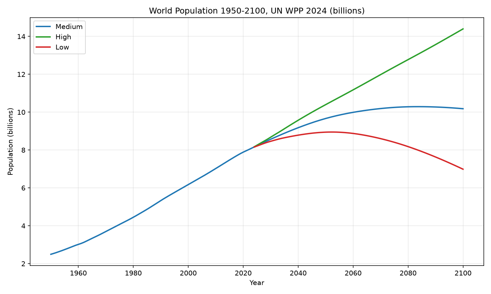

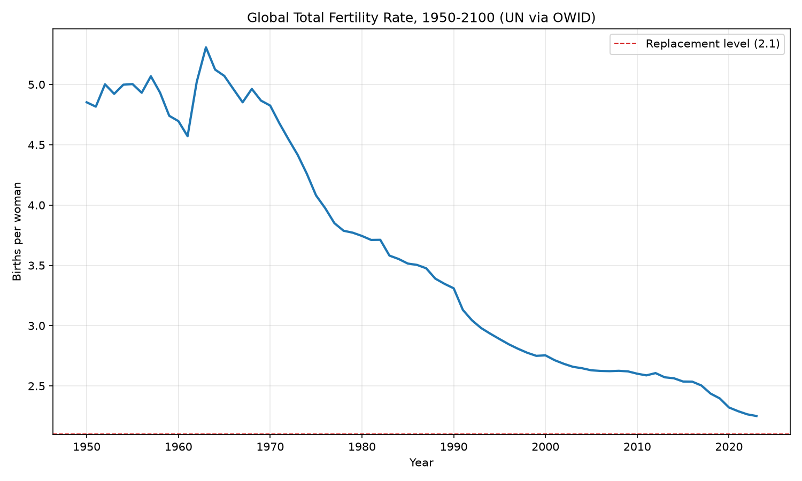

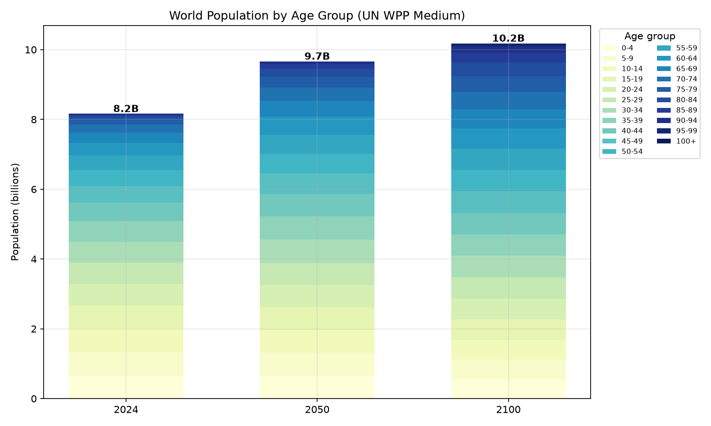

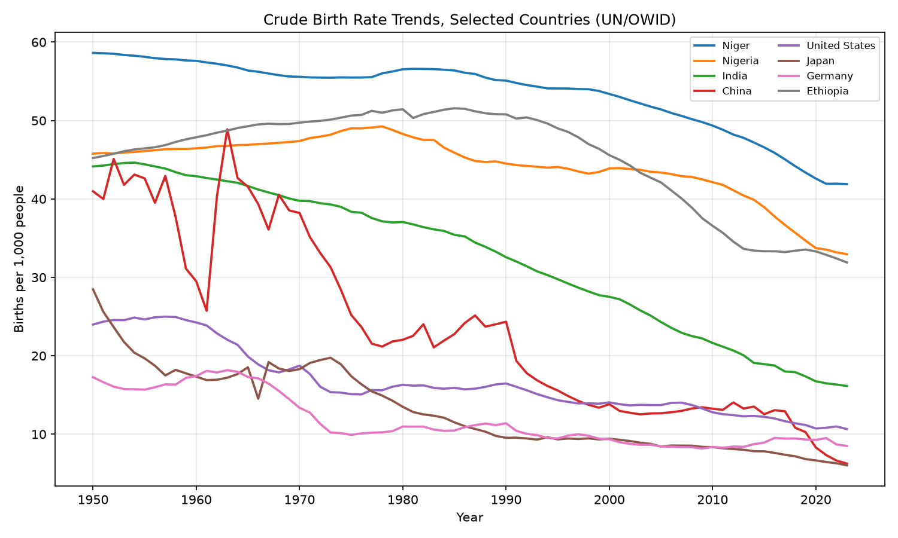

The setup from the main report, compressed for this analysis:

| Indicator | Value | Source |
|-----------|-------|--------|
| World TFR (2024) | ~2.25 | UN WPP 2024 / OWID |
| World TFR (2100, Medium) | ~1.8 | UN WPP 2024 |
| World TFR (2100, IHME) | 1.59 | Lancet/IHME 2024 |
| Countries below replacement (TFR < 2.1) | ~2/3 of all countries; >50% of world population | UN 2024 |
| 65+ share of world population | 10.2% (2024) → ~24% (2100) | UN WPP 2024 |
| Population peak (Medium) | ~10.3B mid-2080s | UN WPP 2024 |
| Population 2100 (IHME) | ~8.8B, declining from ~2060 | Lancet 2024 |

**Key 2023–24 national TFRs** (official vital statistics where available; OECD/NCHS/Eurostat):

| Country | TFR (latest) | Note |
|---------|-------------|------|
| South Korea | **0.72** (2023) | Lowest recorded national figure in modern data |
| China | ~1.0–1.2 [verify] | 2022 population peak; births falling since |
| Japan | **1.20** (2023, vital stats); 1.26 (2022) | 8th consecutive annual birth decline |
| Italy / Spain | ~1.2 | Record-low EU registration year 2023 |
| Germany | ~1.35 | Below EU average |
| **EU-27 average** | **~1.34–1.38 (2023–24)** | Eurostat records the lowest-ever EU total |
| United States | **1.62** (2023) | CDC/NCHS provisional vital statistics |
| France | ~1.5 (2024 provisional) | Falls below 1.6 for the first time in modern series |
| Nordic countries | 1.4–1.5 | Sustained post-2010 decline despite generous policy |

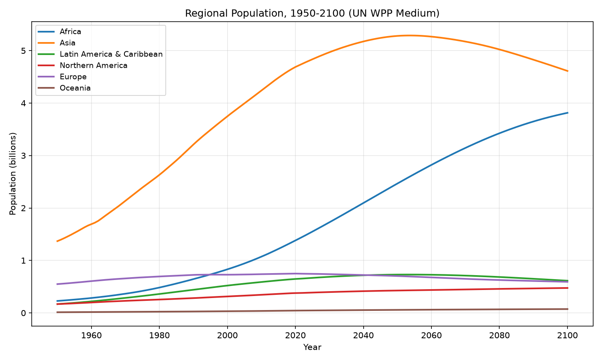

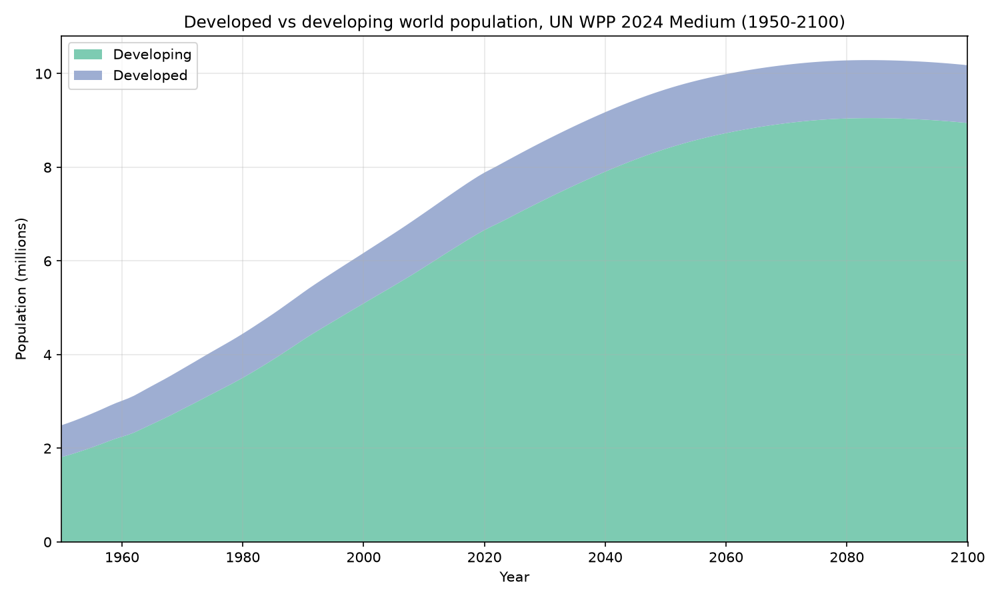

The critical structural fact for everything that follows: **fertility decline is fastest precisely in the regions that will dominate the world economy over the next 40 years** — East Asia, and increasingly South Asia and Latin America. Africa alone retains above-replacement fertility, and even there urban fertility is falling.

---

## Part II — Macroeconomic consequences

## 3. The demographic dividend in reverse

The best-quantified economic framework is the **demographic dividend** literature (Bloom & Williamson 1998; Bloom, Canning & Sevilla 2003, RAND MR-1274; Lee 2003, *Journal of Economic Perspectives*):

- A falling dependency ratio (working-age share rising) boosts growth because savings rise, capital deepens, and women's labor participation increases.
- East Asia's 1965–1990 miracle is estimated to owe **roughly one-third of its GDP-per-capita growth** to demographics alone (Bloom & Williamson 1998).
- Sub-replacement fertility reverses this arithmetic: the working-age share peaks and then **shrinks in absolute numbers**. Japan crossed this line around 1995–2000; China around 2012–2015 (working-age population peaked ~2012; total population peaked 2022 [verify exact year]); Korea's working-age population began falling in 2017.

The dividend does not mechanically become a *tax* — the same literature emphasizes that East Asia captured its dividend through policy (export-led growth, education, savings institutions), and that aging countries can soften the reversal the same way (Later retirement, higher female participation, productivity policy). But the baseline drift is negative.

## 4. Does aging actually slow growth? The evidence map

The academic review (`population_aging_research_report.md`) identifies four main empirical positions:

1. **Growth drag is real and large.** Maestas, Mullen & Powell (2020, *JME*): a 10-percentage-point rise in the 60+ population share reduces per-capita GDP growth by ~5.5% in US state-level panel data, with most of the effect through slower labor-productivity and labor-supply growth.
2. **Aging can raise growth via capital deepening.** Eggertsson, Mehrotra & Robbins (2019): in secular-stagnation models, aging lowers real interest rates and raises *output per worker* through capital deepening even as total growth slows; the effect is mechanism-dependent.
3. **Automation partially offsets aging.** Acemoglu & Restrepo (2022, *JEP*): countries with faster aging adopt more robotics; the productivity gains offset part — not all — of the labor-supply decline. A 2026 Japanese causal study of nursing homes [verify citation before quoting] finds AI/care-robot adoption measurably offsets care-worker shortages without degrading quality — the strongest concrete automation-offset evidence to date.
4. **Historical context matters.** Ronald Lee (2003): transfers across ages dominated most of human demographic history; institutional adaptation (pensions, health systems, retirement norms) has repeatedly absorbed larger age-structure shifts than today's.

**Bottom line:** aging is a genuine, measurable headwind to aggregate growth — but the range of estimates is wide, and the offsetting levers (productivity, automation, participation) are real. The honest framing is *slower growth and rising transfer burdens*, not collapse.

## 5. The interest-rate and macro-financial debate

Fertility decline interacts with saving and investment in ways that are still contested:

- **Secular stagnation channel** (Summers; Eggertsson et al. 2019): lower fertility → lower investment demand and higher precautionary saving → persistently low real rates and weak demand. Japan since the 1990s is the canonical case.
- **Asset-price channel**: pension-fund accumulation then drawdown creates predictable buy/sell waves (pot-belly effect); aging populations are argued to depress equity risk premia over decades [verify — this remains a live academic debate, e.g., Geanakoplos, Magill & Quinzii].
- **Deflationary pressure**: Japan's experience — aging + deleveraging + weak demand = decades of low inflation despite massive monetary easing — is the template macro-financial worry for China and Korea.

## 6. Fiscal consequences: pensions, health, and dependency arithmetic

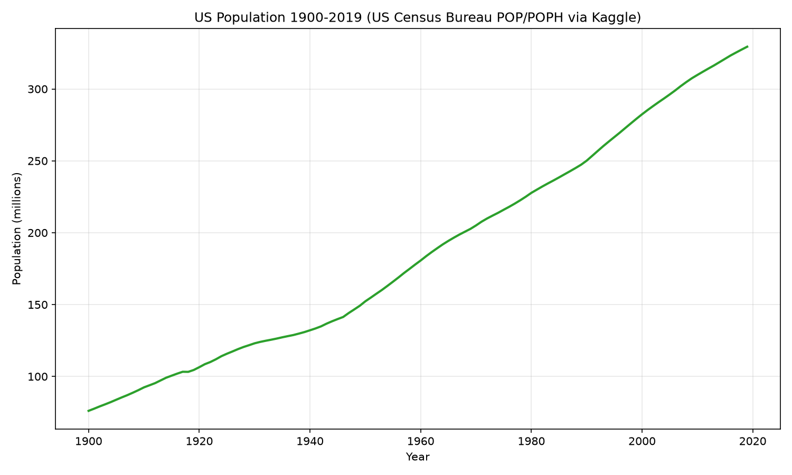

This is the most mechanical part of the analysis: pay-as-you-go pension systems need roughly 2–3 workers per beneficiary to remain stable at current benefit levels.

- **Japan**: OECD projects population **−45% and employment −52% by 2100**. The 2004 pension reform built in an automatic demographic stabilizer (the "macroeconomic slide," マクロ経済スライド) that cuts real benefits as the worker/beneficiary ratio falls — the most explicit acknowledgment that demography overrides politics.
- **China**: the Chinese Academy of Social Sciences modeling (2019) projects the combined urban-worker pension fund **running out around 2035** [verify], with the old-age dependency ratio roughly doubling by 2050 and the 65+ share moving from ~15% toward ~30% by mid-century.
- **Korea**: has the fastest-aging rich-country profile on record — a 65+ share rising toward ~40% by 2050 — with pensions, long-term care insurance, and national debt (already >100% of GDP [verify]) all expanding together.
- **Europe**: the EU Ageing Report 2024 projects age-related public spending rising by several percentage points of GDP by 2050 under current policy, with country dispersion driven mainly by pension-system design.
- **US**: Social Security's trustees project trust-fund depletion in the mid-2030s with a permanent ~20% benefit cut absent reform [verify current projection year] — mild by OECD standards, but the politics are the binding constraint.

The general pattern: **every aging society eventually faces the same three-way choice** — raise taxes, cut benefits, or import workers (or some combination). Delay makes each option worse because the population structure compounds.

---

## Part III — Case studies

## 7. Japan: the first-mover problem

Japan is roughly 25 years ahead of the rest of the rich world demographically, making it the best natural experiment for what sub-replacement fertility does over a full generation.

**The numbers:**
- TFR 1.20 (2023 vital statistics; 1.26 in 2022); births fell **−5.1% year-over-year in 2023**, the 8th consecutive annual decline (MHLW data, reported by CNN, March 2024).
- Population: 124.9M (2023) → **87.0M projected by 2070** (National Institute of Population and Social Security Research; CSIS briefing, November 2023).
- 65+ share: ~29% — the highest of any large economy.
- OECD long-run projection: population **−45%, employment −52% by 2100**.

**Documented causes:**
- **The child penalty is severe and gendered**: the widely cited figure is that Japanese mothers' employment drops by ~44.5% relative to pre-birth levels [verify against original study — likely Kawaguchi/others], while fathers' is negligible.
- Housing and labor-market rigidity: long work hours, the dual (regular/non-regular) employment system, and urban housing costs all act as fertility suppressants.
- Marriage decline is the proximate driver: non-marital births remain ~2% of all births (vs ~40% OECD average), so falling marriage rates translate almost one-for-one into falling births.

**Policy record:**
- **Angels Plan / New Angels Plan** (1994, 1999): childcare infrastructure expansion.
- **Cohen, Fujiwara & Harmon (2013)** — the best-identified study of Japanese cash policy: fertility-support allowances raised fertility by **up to 19.2%** in treated municipalities, but much of the effect was **timing advancement** rather than completed fertility.
- **Kōseishō "childcare waitlist" reforms (2013–)** and work-style reform (2019) with caps on overtime — the reconciliation turn.
- Result so far: TFR rose from ~1.26 (2005) to ~1.45 (2015) then fell back to ~1.2. Demography's momentum beat policy momentum.

## 8. South Korea: the high-spend, low-result cautionary tale

- **Spending**: ~380 trillion won (over **$200 billion**) in pro-natal programs since 2006 [verify total], peaking in the 2020s — roughly 1–2% of GDP per year at times.
- **Result**: TFR fell from 1.19 (2010) to a modern-record **0.72 (2023)** — the deepest sustained low-fertility equilibrium observed in any country.
- 2024 provisional data show the first uptick (TFR ~0.75 [verify]) after marriage rates rebounded post-COVID — a reminder that timing effects can masquerade as policy success.
- **Structural drivers** that spending did not touch: extreme gender-role asymmetry, housing costs (Seoul apartment prices), private-education arms races (hagwon), and a work culture hostile to dual-earner parenting. Korea's **child penalty** and gender-wage-gap are the worst in the OECD.
- Political response: creation of a dedicated **Ministry-level planning office** (2024) and a shift in rhetoric from cash to "structural" fixes.

**Lesson:** money without structural change fails. Korea spent a mid-sized economy's worth of fiscal capacity on policies that did not alter the underlying couple-level and workplace constraints.

## 9. China: the policy-reversal trap

- Population peaked in **2022** [verify exact year] and began declining — the first decline since the 1960s famine era.
- TFR ~1.0–1.2 [verify] after the end of the one-child policy (2016 two-child, 2021 three-child).
- The age structure is aging *before getting rich*: 65+ share ~15% heading toward ~30% by 2050, with GDP per capita a fraction of Japan's at the equivalent demographic point.
- Pension arithmetic: CASS 2019 modeling projects fund depletion ~2035 [verify]; the household-registration (hukou) system fragments the labor response.
- Pro-natal measures (subsidies, relaxed restrictions, propaganda) have had negligible measured effect; birth registrations keep falling.

**Lesson:** China shows that fertility suppression is easy and fertility restoration is not. Two generations of low fertility built norms, housing stock, and family economics that policy reversal could not unwind.

## 10. Europe: from laggards to leaders to relapse

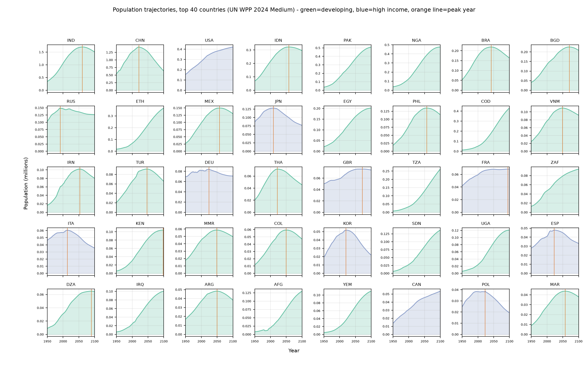

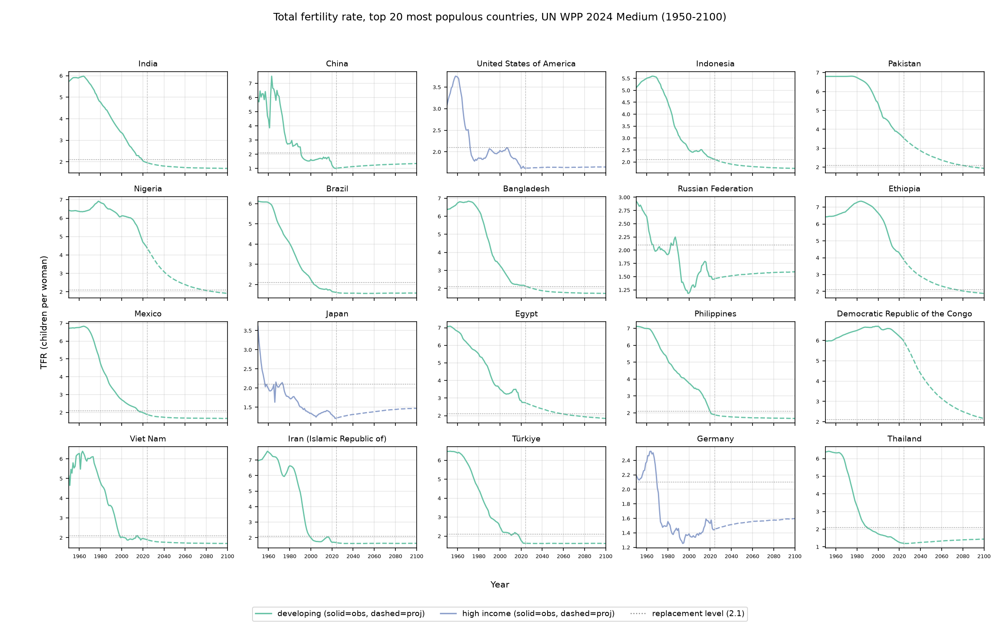

- **EU-wide**: Eurostat records the **lowest-ever EU TFR (~1.34–1.38) in 2023–24**, with Italy and Spain at ~1.2.
- **Southern Europe** (Italy, Spain, Greece): pioneered low fertility despite weak state support — the "familistic welfare" failure, where family care burden falls on households (and largely on women) without public childcare.
- **France and the Nordics** (1990s–2015): the demonstration case that reconciliation policy works — generous leave, universal childcare, parental sharing incentives (Sweden's "daddy months") held TFR near 1.8–2.0 for a generation.
- **The relapse (2016–present)**: France fell to ~1.5 (2024 provisional, IGAS review commissioned 2026); all Nordic countries fell to 1.4–1.5. The post-2010 fertility decline hit *generous-policy* countries as hard as stingy ones — the strongest empirical argument that policy cannot fully offset broad economic/cultural shifts (uncertainty, delayed partnership, housing).
- **Newer aggressive programs**: Hungary (below), Poland's 500+/800+ cash program (GUS evaluation found modest, mostly timing, effects on fertility [verify]), Germany's parental benefit (Bundeselterngeld) and childcare guarantee.

## 11. Hungary: the maximal-effort test case

- Family spending pushed to **~5% of GDP** — the highest share in the OECD (CSOK housing subsidies, tax credits per child, lifetime income-tax exemption for mothers of 4+, baby loans forgiven on the third child).
- Official TFR: 1.23 (2010) → **~1.5–1.6 peak (2021)** [verify; later years show decline back toward ~1.4].
- Independent assessment: the rise is real but modest relative to spending; part is timing and part is selection (higher fertility among rural/religious populations the policy targets). Emigration of working-age adults worsens the dependency arithmetic regardless of TFR.
- Hungary is the natural-experiment upper bound: **even the most expensive pro-natal program in the world restored only a fraction of lost fertility.**

---

## Part IV — What works: the policy evidence

## 12. The couple-level turn: Doepke & Kindermann

The most influential modern policy paper is **Doepke & Kindermann (2019, *AEA Papers & Proceedings*), "Love, Money, and Parental Care"**:

- Fertility decisions are **couple decisions**; births happen where partners' fertility preferences converge.
- The binding constraint in most low-fertility countries is not total income but **who bears the cost**: where the mother bears a large "child penalty," second and third births fail at the preference-conflict stage.
- Policy that **redistributes parental cost between partners** (parental leave reserved for fathers, childcare that doesn't require one parent to exit the labor force, normalized part-time work) raises fertility more effectively per unit of spending than cash transfers.
- This explains the France/Sweden success (1990s–2010s), the Japan/Korea failure (cash + rhetoric, weak redistribution), and — with caveats — why even successful countries declined after 2016.

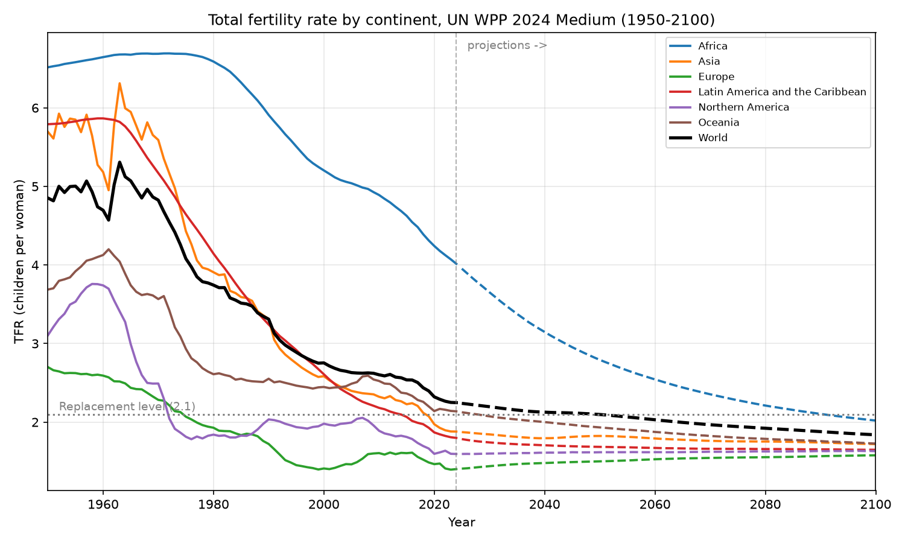

## 13. The evidence on each instrument

| Instrument | Evidence | Assessment |
|-----------|----------|-----------|
| **Cash transfers** | Israel extramarital-child-benefit quasi-experiment (Cohen, Einav & Mayshar / related work): strong responses; Japan municipal allowances: up to +19.2% (Cohen et al. 2013); Poland 500+: small net effect, mostly timing [verify] | Works on **timing** and possibly completed fertility at the margin; expensive per additional birth; does not fix structural constraints |
| **Childcare provision** | Cross-country and within-country evidence consistently positive where availability was previously scarce (Quebec's mixed legacy; Germany's East/West contrast) | Best-documented reconciliation lever |
| **Parental leave (with father quotas)** | Nordic design evidence; Iceland/Sweden father-quota studies show shifted care distribution | Effective as a bundle, not as leave alone (long mother-only leave *lowers* fertility in some studies) |
| **Housing policy** | Strong micro evidence that housing costs suppress fertility (UK, Korea, US metro analyses) | High-leverage but politically hard |
| **Labor-market reform** | Regular/non-regular employment tracks with fertility in Japan/Korea; secure contracts correlate with family formation | Indirect but structurally important |
| **Immigration** | US/Canada/Australia histories; Canada's 2023–24 intake cuts [verify current figures] show political fragility | Offsets workforce aging directly; does not raise native TFR; second-generation fertility converges down |
| **Retirement/pension reform** | Working-longer reforms offset labor shrinkage mechanically | Essential for fiscal arithmetic, irrelevant to fertility itself |
| **Automation & AI** | Acemoglu–Restrepo cross-country; 2026 Japanese care-sector causal study [verify] | Real but partial offset to *labor shortages*; does nothing for pension ratios directly |

## 14. The honest policy synthesis

1. **No known policy restores replacement fertility once a low-fertility equilibrium sets in.** Hungary's maximal effort moved TFR by ~0.2–0.3; Korea's $200B+ moved nothing structural.
2. **The highest-evidence bundle is reconciliation policy** (childcare + father-inclusive leave + normalizing maternal employment) *plus* housing and employment security — the France/Sweden recipe — and even that holds TFR near 1.6–1.8, not 2.1, in the current environment.
3. **Timing effects are real and worth having** (deferring decline), but must not be sold as restoration.
4. **The fiscal side has its own levers independent of fertility**: later retirement, higher female and older-worker participation, productivity investment, automation adoption, and pension-system redesign (automatic stabilizers, multi-pillar funding).
5. **Immigration is the fastest demographic instrument available** — it moves the working-age population immediately — but is politically constrained everywhere it's most needed (Japan, Korea, Italy, and increasingly the US and Canada).

---

## Part V — The contrarian case: is this even a crisis?

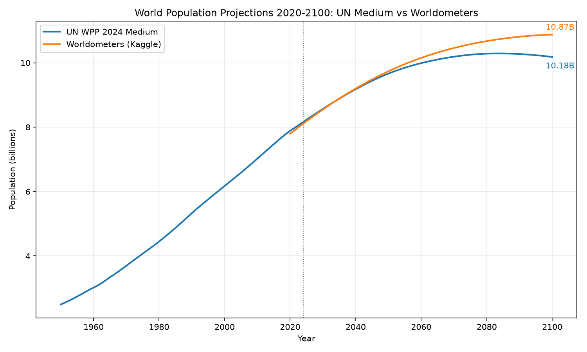

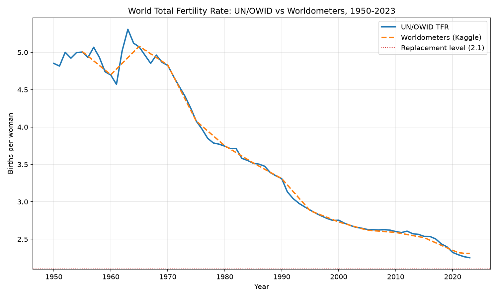

## 15. *Empty Planet* and the overshoot critique

**Bricker & Ibbitson (2019, *Empty Planet*, Crown)** argue:

- **The UN's Medium projection habitually overshoots.** Historical UN revisions have repeatedly revised *downward*; the Low scenario may effectively be the Medium of 20 years hence. The IHME/Lancet 2024 forecast (1.59 by 2100, peak ~2060, population *falling* to ~8.8B) is a mainstream institution saying much the same.
- **Urbanization is the hidden fertility killer.** As Africa urbanizes at East-Asian speed, city fertility norms (1.3–1.7) will dominate faster than models currently assume.
- **Depopulation is manageable**: capital substitution, robotization, higher retirement ages, and continued per-capita growth can keep living standards rising with flat or falling headcounts. The "aging crisis" framing, they argue, is dominated by pension-system design problems, not demographic inevitability.

## 16. Assessing the contrarian case honestly

**Where it is strong:**
- UN Medium-vs-Low spread at 2100 is enormous (10.2B vs 7.0B); forecasting error is real and systematically one-directional in the historical record [verify revision history].
- Several once-"certain" milestones (e.g., Nigeria's projected size) have already been revised down sharply.
- Policy discourse overweighting headcount and underweighting per-capita welfare is a genuine analytical error.

**Where it is weak:**
- It understates the *speed* problem: even under optimistic fertility paths, the 65+ share keeps climbing for decades because today's children are already born (demographic momentum runs both ways).
- Its institutional-optimism assumption (robots + productivity + reform) has no working large-country demonstration yet — Japan is the test case, and its experience is a grind, not a vindication.
- The claim that per-capita welfare is unaffected by aging is contradicted by the fiscal arithmetic in every pay-as-you-go system examined.

**The synthesis position:** the *direction* (aging, shrinking working-age shares) is certain; the *magnitude and speed* (UN Medium vs IHME vs Empty Planet) is genuinely uncertain by a factor large enough to change policy design. Prudent policy should be robust across the whole range — which, conveniently, is the same policy set: reconciliation support, later retirement, productivity and automation investment, pension stabilizers, and selective immigration.

---

## Part VI — Open questions and research leads

1. **Timing vs quantum**: disentangle how much of observed policy response is tempo (postponement) vs completed fertility — the central unresolved measurement problem in pro-natal evaluation.
2. **The post-2016 decline in generous-policy countries**: why did France and the Nordics fall? Candidate mechanisms: uncertainty (climate/economic), partnership delay, social-media dating markets, housing. None yet pinned down causally.
3. **Automation offsets at scale**: how much of labor-supply decline can robot/AI adoption absorb in care, construction, and agriculture — the sectors aging hits first? The Japanese care-sector causal evidence is the frontier.
4. **Pension-system robustness**: which designs (automatic demographic stabilizers vs parametric reform vs funded pillars) have survived actual demographic stress best? Japan's macroeconomic slide vs Sweden's NDC system are the live comparisons.
5. **Immigration's second-generation dynamics**: convergence of migrant-descendant fertility toward native levels varies by origin and integration — how fast, and what does that imply for long-run projections?
6. **The China unwind**: what does 40 years of one-child policy do to norms that persist after removal? Korea under different conditions, same question.
7. **Health-span vs life-span**: the fiscal projections assume rising health costs per elder; compression-of-morbidity evidence would change the arithmetic materially in the optimistic direction.

---

## Sources

**Datasets (processed in this repo):** UN World Population Prospects 2024; Our World in Data (fertility, population); World Bank `SP.DYN.CBRT.IN`; Gapminder; US Census Bureau projections; CIA World Factbook 2025.

**Academic (full evidence map in `population_aging_research_report.md`):**
- Bloom, D. & Williamson, J. (1998). "Demographic Transitions and Economic Miracles in Emerging Asia." *World Bank Economic Review*.
- Bloom, D., Canning, D. & Sevilla, J. (2003). *The Demographic Dividend: A New Perspective on the Economic Consequences of Population Change*. RAND MR-1274.
- Lee, R. (2003). "The Demographic Transition: Three Centuries of Fundamental Change." *Journal of Economic Perspectives* 17(4).
- Maestas, N., Mullen, K. & Powell, D. (2020/2023). "The Effect of Population Aging on Economic Growth, the Labor Force, and Productivity." *Journal of Macroeconomics* / NBER WP 22452.
- Acemoglu, D. & Restrepo, P. (2022). "Demographics and Automation." *Journal of Economic Perspectives* 36(1).
- Eggertsson, G., Mehrotra, N. & Robbins, J. (2019). "Demographic Trends, the Equity Risk Premium, and Debt." *Journal of Human Capital* (and related secular-stagnation work).
- Doepke, M. & Kindermann, F. (2019). "Love, Money, and Parental Care: The Political Economy of Fertility." *AEA Papers & Proceedings* 109.
- Cohen, A., et al. (2013). Cash-incentive fertility effects in Japanese municipalities. [verify exact citation]

**Policy and press (key sources):**
- OECD. *Pensions at a Glance* (multiple years); OECD long-run employment projections cited for Japan −45%/−52% by 2100.
- Eurostat. Fertility statistics (EU TFR record low, 2023–24).
- CNN (March 1, 2024). "Japan's births fell for the 8th straight year" — MHLW vital statistics.
- CSIS (November 9, 2023). "Japan's population: 124.9M to 87.0M by 2070" — National Institute of Population and Social Security Research briefing.
- Chinese Academy of Social Sciences (2019). Pension fund actuarial report. [verify]
- European Commission. *2024 Ageing Report*.
- IGAS (France, 2026). Family-policy review commission. [verify]
- Polish GUS evaluations of the 500+/800+ program. [verify]
- IRCC (Canada). 2024–2025 immigration-levels announcements. [verify]

**Books:**
- Bricker, D. & Ibbitson, J. (2019). *Empty Planet: The Shock of Global Population Decline*. Crown.
- related: Last, J.V. (2013). *What to Expect When No One's Expecting*. (contrarian-adjacent)

*Figures flagged [verify] are drawn from structured research notes and should be checked against the primary source before formal quotation.*
