# World Population, Birth Rates, and Long-Term Projections

A multi-source analysis built on UN World Population Prospects 2024, Our World in Data, the World Bank, Gapminder, and the CIA World Factbook. All processed datasets live in `data/processed/`, charts in `charts/`.

---

## 1. Executive summary

- The world population reached **8.16 billion in 2024** (UN WPP 2024). Under the **Medium scenario** it grows to **9.66 billion by 2050** and **10.18 billion by 2100**, peaking at roughly **10.3 billion around the mid-2080s** before a slow decline begins.
- Projection uncertainty is large: by 2100 the **High scenario reaches 14.4 billion** while the **Low scenario is 6.99 billion** — a range wider than today's entire population.
- Global fertility has collapsed from **~4.85 children per woman in 1950** to **~2.25 today**, and the UN projects it falls below replacement (~2.1) during the 2050s, ending near **1.8 by 2100**. Independent modelers (IHME/Lancet) project an even lower **1.59 by 2100**.
- The age structure is transforming: the **65+ population triples from 0.83B (2024) to 2.44B (2100)**, while the under-15 population shrinks in absolute terms.
- The growth engine shifts decisively to **Africa**, whose population rises from 1.52B (2024) to **3.82B (2100)** while Asia peaks near 5.3B in the 2050s and declines.

---

## 2. Historical world population and projection variants

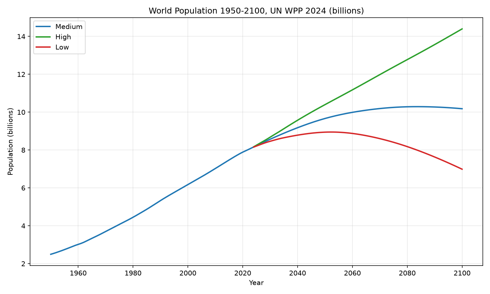

The world population took roughly 200,000 years to reach 1 billion (around 1800) but only ~200 years to reach 8 billion. The historical record (solid lines, 1950–2024) shows near-exponential growth decelerating in recent decades:

| Year | World population (UN WPP) |
|------|--------------------------|
| 1950 | ~2.5 billion |
| 1975 | ~4.1 billion |
| 2000 | ~6.1 billion |
| 2024 | **8.16 billion** |
| 2050 (Medium) | 9.66 billion |
| 2100 (Medium) | **10.18 billion** |

**Scenario spread at 2100** (full WPP variant table in `data/processed/un_wpp_world_population_by_variant.csv`):

| Variant | 2100 population |
|---------|----------------|
| Low | 6.99 billion |
| Medium | 10.18 billion |
| High | 14.40 billion |
| 95% prediction interval | 9.05 – 11.44 billion |
| Constant fertility | 18.19 billion |
| Instant replacement | 10.84 billion |
| Zero migration | 10.10 billion |

The dominant uncertainty is **fertility**, not mortality or migration: the constant-fertility variant (18.2B) versus the Low scenario (7.0B) spans the entire range of plausible futures. Even under Medium, growth turns negative near the mid-2080s.

---

## 3. The fertility transition

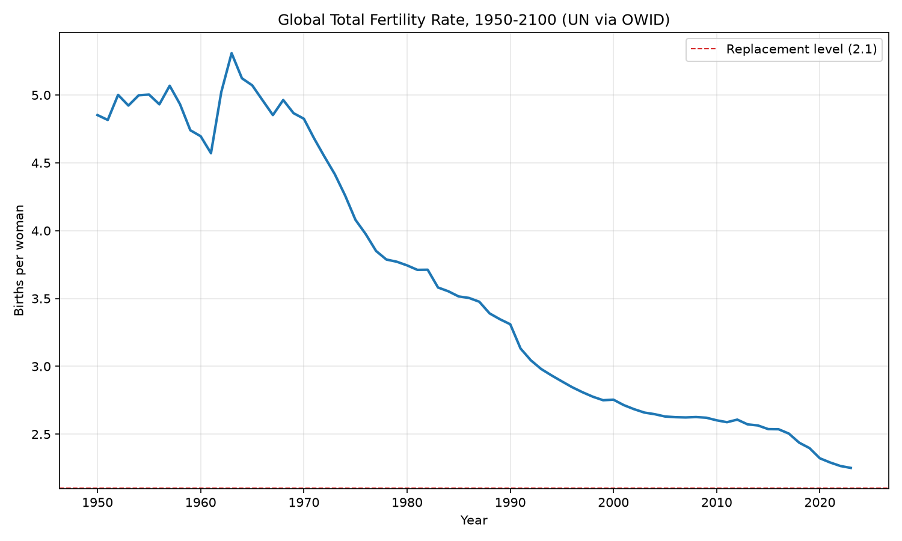

Global total fertility rate (TFR, children per woman; OWID/UN series):

| Year | World TFR |
|------|-----------|
| 1950 | 4.85 |
| 1980 | 3.74 |
| 2000 | 2.75 |
| 2020 | 2.32 |
| ~2024 | ~2.25 |

The transition is one of the fastest social shifts in history: fertility fell by more than half in two generations, driven by urbanization, female education, contraception access, and child mortality decline. The UN World Fertility and Family Planning 2024 report notes global TFR fell from 5 in 1963 to 2.2 today and projects **~1.8 by 2100** — below replacement (2.1). The IHME/Lancet 2024 forecast is more aggressive: **1.59 by 2100**, with sub-Saharan Africa producing **54.3% of all world births by 2100**. The 80% of countries already below replacement will age rapidly; only high-fertility Africa and parts of Asia still grow through births.

---

## 4. Birth rates across independent sources

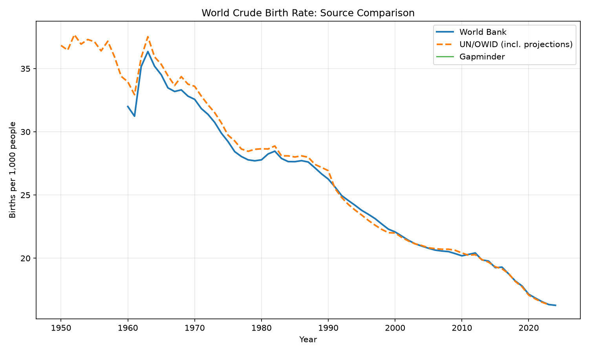

Three fully independent data pipelines agree closely on the world crude birth rate (CBR, births per 1,000 population):

| Source | 1950 | 1980 | 2020s |
|--------|------|------|-------|
| OWID (UN-derived) | 36.8 | 28.7 | ~17.1 |
| World Bank (`SP.DYN.CBRT.IN`) | ~36–37 | ~28–29 | ~16–17 |
| Gapminder | ~37 | ~29 | ~17 |

Convergence between UN-derived, World Bank, and Gapminder series validates the underlying vital-registration and census infrastructure. The world CBR has fallen to roughly **one-third of its 1950 value** — the clearest single indicator that the demographic transition is global and mature.

---

## 5. Age structure: from youth bulge to aging world

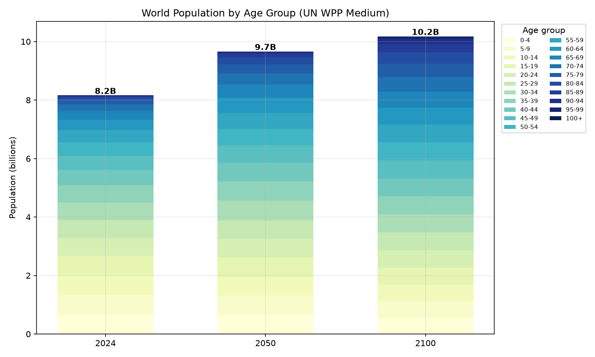

World population by broad age group, Medium scenario (from `un_wpp_age_groups_medium_1950_2100.csv`):

| Group | 2024 | 2050 | 2100 |
|-------|------|------|------|
| 0–14 | 2.02B (25%) | 1.97B (20%) | 1.68B (16%) |
| 15–64 | 5.31B (65%) | 6.12B (63%) | 6.06B (60%) |
| 65+ | 0.83B (10%) | 1.58B (16%) | **2.44B (24%)** |

Key implications:

- The **0–14 cohort never grows again** under Medium — childhood population is at its all-time maximum right now.
- The **65+ population triples** by 2100, nearly matching the working-age population of 2024 in absolute size.
- By 2100, one in four people worldwide will be 65 or older — a level today seen only in Japan and a handful of European countries. Pension systems, healthcare demand, and labor markets will be reshaped everywhere.

---

## 6. Regional dynamics: Africa takes the baton

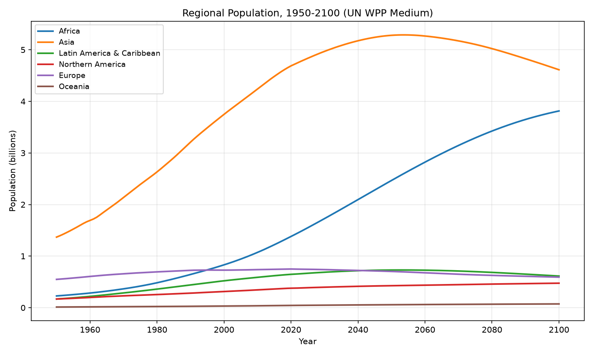

Regional populations (UN WPP Medium; `LocID` mapping verified against the Location column):

| Region | 1950 | 2024 | 2100 |
|--------|------|------|------|
| Asia | 1.4B | ~4.8B | 4.6B (peak ~5.3B in 2050s) |
| Africa | 0.23B | **1.52B** | **3.82B** |
| Europe | 0.55B | 0.75B | 0.60B |
| Latin America & Caribbean | 0.17B | 0.66B | 0.62B |
| Northern America | 0.17B | 0.39B | 0.48B |
| Oceania | 0.01B | 0.05B | 0.08B |

Asia delivered ~3.4 billion of the growth between 1950 and today, but peaks within 30 years. Africa is the only region with sustained 2100 growth: it adds ~2.3 billion people — **more than the world's entire population in 1950** — and overtakes Asia in population share trajectory. Europe is the only major region whose 2100 population is smaller than its 1950 population.

---

## 7. Country-level birth rates today

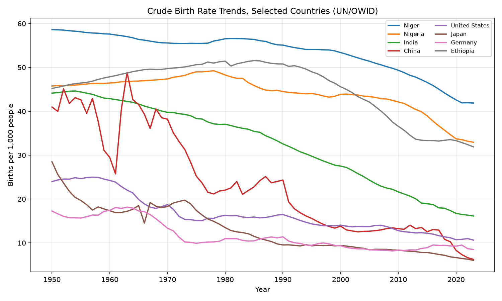

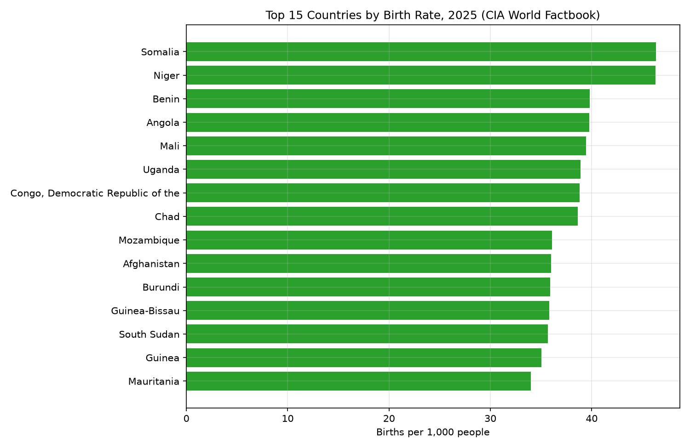

The CIA World Factbook (2025, `cia_factbook_birth_rates_1990_2025.csv`, 275 countries, AFRICOM/CENTCOM/EUCOM/INDOPACOM/SOUTHCOM/OTHER regional groupings) shows the global range in birth rates:

**Highest (births per 1,000/year):**

| Country | Birth rate |
|---------|-----------|
| Somalia | 46.4 |
| Niger | 46.3 |
| Benin | 39.8 |
| Angola | 39.8 |
| Mali | 39.4 |
| Uganda | 38.9 |
| DR Congo | 38.8 |
| Chad | 38.6 |
| Mozambique | 36.1 |
| Afghanistan | 36.0 |

**Lowest:**

| Country | Birth rate |
|---------|-----------|
| South Korea | **4.3** |
| Ukraine | 6.2 |
| Monaco | 6.5 |
| Japan | 6.8 |

The spread — Somalia at 46.4 vs. South Korea at 4.3, a **10x gap** — is the widest in recorded demographic history. Every one of the top 15 highest-birth-rate countries is in sub-Saharan Africa except Afghanistan. Long-run country series (Gapminder, `gapminder_merged.csv`) show the same transition country by country: today's low-fertility leaders were themselves above 4 children per woman within living memory.

---

## 8. Source comparison and data quality

| Source | Coverage | Strengths | Limitations |
|--------|----------|-----------|-------------|
| **UN WPP 2024** | All countries + regions, 1950–2100 | Gold standard; probabilistic variants; age/sex detail | Projections, not forecasts — wide 2100 uncertainty |
| **OWID** | Countries, 1950–2100 | Clean harmonization of UN/GM/IHME series | Largely a repackaging of primary sources |
| **World Bank** | Countries, ~1960–2023 | Independent vital-stats compilation | No projections; lagging coverage in poor countries |
| **Gapminder** | Countries, 1800–2100 | Longest historical horizon | Estimates (not observations) pre-1950 |
| **CIA World Factbook** | 275 countries, 1990–2025 | Current-year estimates; broad country set | Single-year snapshot style; US-intel definitions |
| **Worldometers (Kaggle)** | World, 1955–2023 + projection to 2100 | Independent tracker lineage; 5-yr historical intervals | Web-scrape derived, not a primary vital-stats source |
| **US Census Bureau (Kaggle)** | US, 1900–2019 (POP/POPH) | Direct official time series; longest US record | US only; monthly/annual granularity mismatch handled |
| **UN WFD 2019 (Kaggle)** | 201 countries, survey-based TFR ~1950–2018 | Survey-referenced estimates with named data source per point | Developing-country focus; US and most high-income OECD absent |

### Kaggle validation sources

Three Kaggle datasets were added as independent validation/lineage sources.

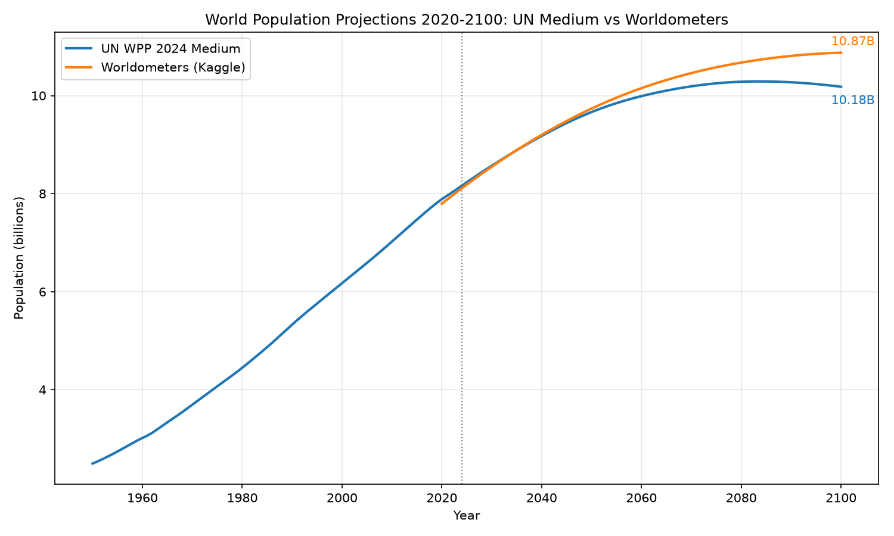

The most interesting divergence is the 2100 endpoint: Worldometers' projection lands at **10.87B vs the UN Medium 10.18B** — a ~690M gap, roughly the population of Europe — driven by slower assumed fertility decline. The historical (pre-2024) tracks agree closely.

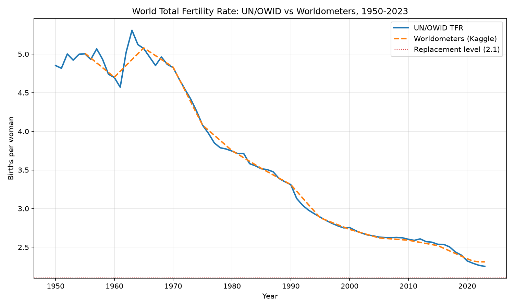

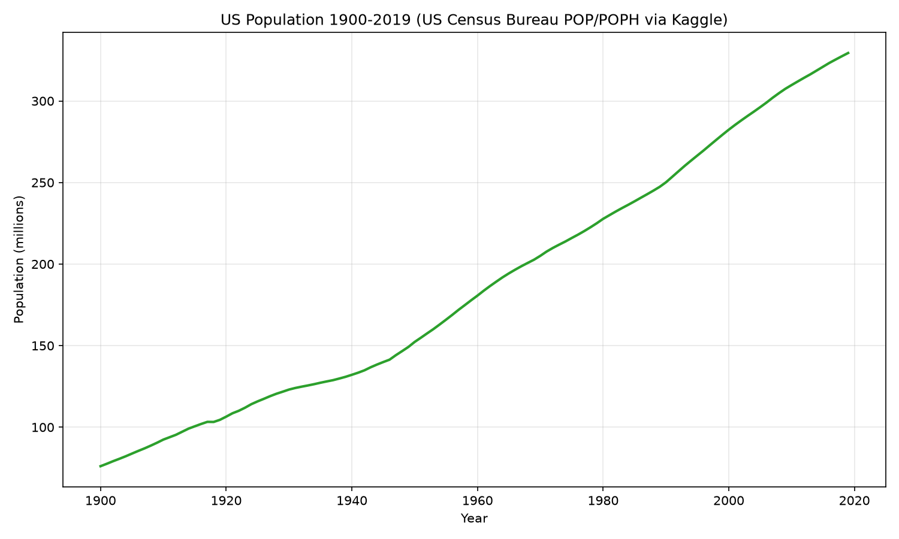

Survey-based TFR (UN WFD 2019, mean of 2015–2019 estimates) vs UN/OWID 2019:

| Country | Survey-based (WFD) | UN/OWID 2019 |
|---------|--------------------|--------------|
| India | 2.28 | 2.12 |
| Nigeria | 5.84 | 4.86 |
| Brazil | 1.74 | 1.71 |
| Japan | 1.44 | 1.32 |
| Germany | 1.56 | 1.54 |

Agreement is tight for low-fertility countries; survey-based estimates run higher where fertility is high (Nigeria +1.0, India +0.16) — consistent with known UN-vs-survey measurement tension. The US is absent from the WFD because it covers developing countries only.

---

## 9. World fertility today — and tomorrow

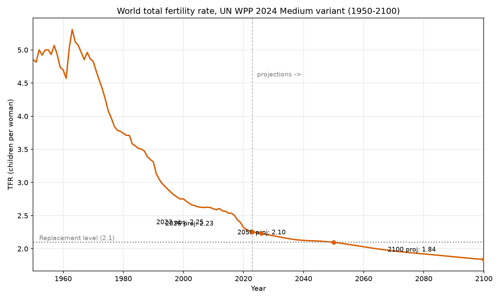

The UN does not publish an *observed* global fertility figure for 2026 — the latest observed estimate is **2.25 children per woman in 2023**. Under the Medium variant, the projected 2026 value is **2.23**, so the practical answer to "what is the world's TFR today?" is **about 2.2 children per woman and still falling**.

| Year | World TFR | Status |
|------|----------:|--------|
| 1950 | 4.85 | observed |
| 2023 | 2.25 | latest observed |
| 2026 | 2.23 | Medium projection |
| 2050 | 2.10 | Medium projection — hits replacement |
| 2100 | 1.84 | Medium projection |

Global fertility crosses the replacement threshold (~2.1) during the **2050s** and keeps declining to **1.84 by 2100** — below replacement for the last half-century of the projection window. Every continental future in the next section flows from this single curve: it is already below replacement in Asia, Europe, Northern America, and Latin America, and is falling fast in Africa (Nigeria 4.48 in 2023, projected 2.23 by 2100).

---

## 10. Continent futures under the Medium variant

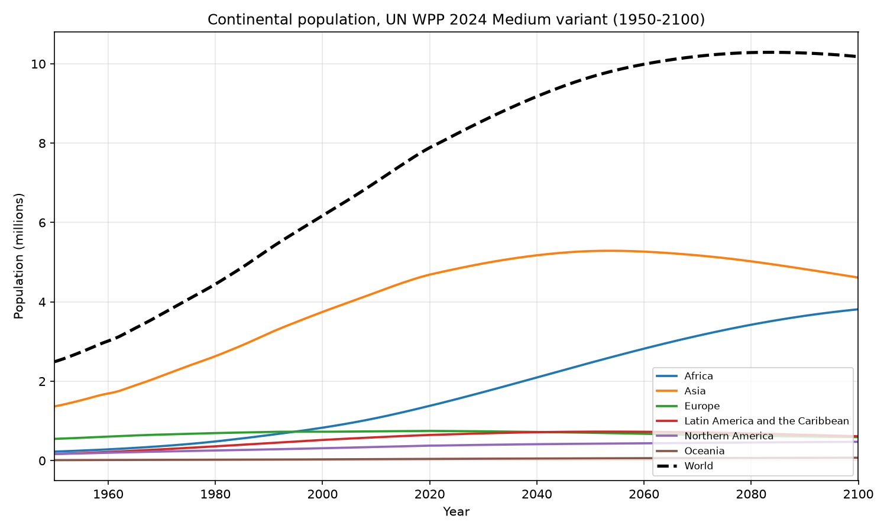

| Region | 2024 | Peak | Peak year | 2100 | Change 2024-2100 |
|--------|-----:|-----:|----------:|-----:|-----------------:|
| Africa | 1.52B | 3.81B (still growing) | 2100 | 3.81B | +151% |
| Asia | 4.81B | 5.29B | 2054 | 4.61B | -4% |
| Europe | 0.75B | 0.75B | 2020 | 0.59B | -22% |
| Latin America & Caribbean | 0.66B | 0.73B | 2053 | 0.61B | -8% |
| Northern America | 0.39B | 0.47B (still growing) | 2100 | 0.47B | +22% |
| Oceania | 0.05B | 0.07B (still growing) | 2100 | 0.07B | +47% |

Three different futures coexist under one scenario. **Africa never peaks** within the century: it more than doubles to 3.81B and continues growing past 2100, containing 37% of humanity by then (up from 19% today). **Asia and Latin America and Europe** have already crested or crest mid-century — Asia's 2054 peak at 5.29B is the largest single population event of the projection, followed by a decline of nearly 700 million by 2100. **Northern America and Oceania** are the only regions whose growth is projected to persist, sustained largely by migration rather than fertility (both sit well below replacement). (Figures in this section are recomputed directly from the WPP2024 Medium file and can differ from section 6's regional table by ±0.01B due to rounding; Africa 3.81B here vs 3.82B there is the same value rounded differently.)

---

## 11. Country futures: the top 20 developed vs developing

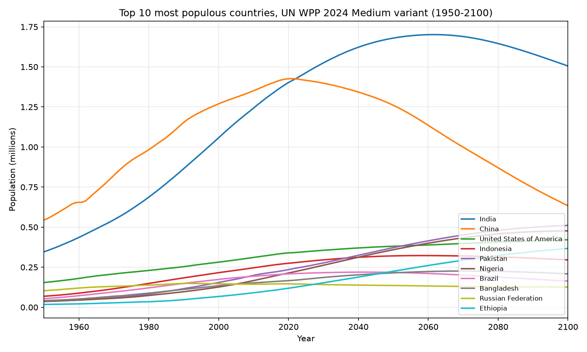
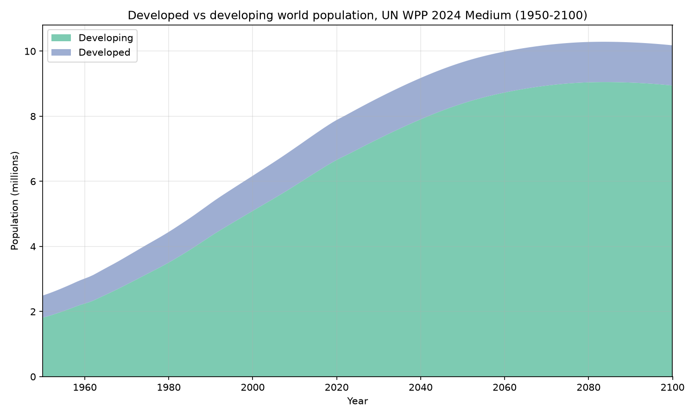
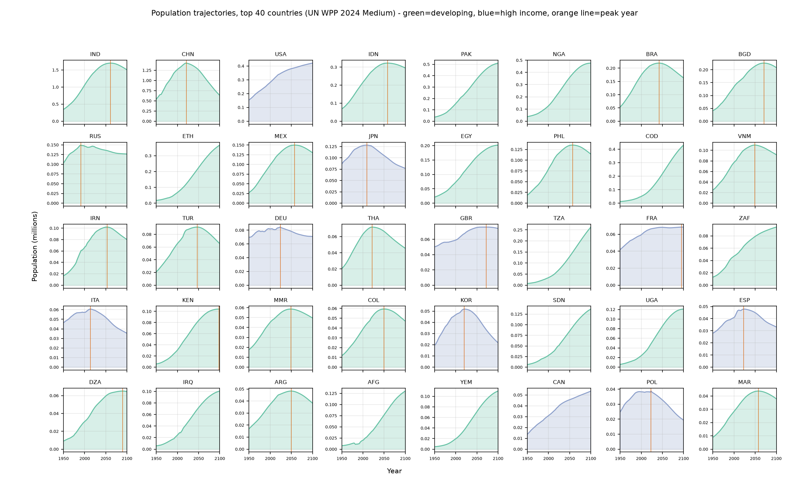

Classification: countries are split by a hand-coded World Bank high-income list (58 high-income, 179 developing). The developed world — now 1.24B people, just 15% of humanity, down from 27% in 1950 — is dominated by two stories: **immigration-sustained growth** (US +10% by 2050, Saudi Arabia +40%, Australia +22%, Canada +15%, UAE +39%) and **demographic contraction** (Korea -13% by 2050 and -58% by 2100, Japan -15%/-38%, Italy -13%/-40%, Taiwan -16%/-57%, Poland -15%/-50%). Of the 58 high-income countries, **36 are already shrinking** in the Medium variant.

| # | Country | Pop 2024 (M) | Pop 2050 (M) | Pop 2100 (M) | Chg 2024-2050 | Peak year | TFR 2023 |
|---|---------|-------------:|-------------:|-------------:|--------------:|----------:|---------:|
| 1 | United States of America | 345.4 | 380.8 | 421.3 | +10.3% | 2100 (still growing) | 1.62 |
| 2 | Japan | 123.8 | 105.1 | 76.8 | -15.1% | 2009 | 1.21 |
| 3 | Germany | 84.6 | 78.3 | 70.9 | -7.4% | 2024 | 1.44 |
| 4 | United Kingdom | 69.1 | 75.5 | 74.3 | +9.2% | 2072 | 1.56 |
| 5 | France | 66.5 | 68.2 | 68.5 | +2.5% | 2095 | 1.64 |
| 6 | Italy | 59.3 | 51.9 | 35.4 | -12.6% | 2014 | 1.20 |
| 7 | Republic of Korea | 51.7 | 45.1 | 21.8 | -12.7% | 2020 | 0.72 |
| 8 | Spain | 47.9 | 44.9 | 33.1 | -6.2% | 2023 | 1.21 |
| 9 | Canada | 39.7 | 45.6 | 53.6 | +14.8% | 2100 (still growing) | 1.35 |
| 10 | Poland | 38.5 | 32.8 | 19.3 | -14.9% | 2023 | 1.30 |
| 11 | Saudi Arabia | 34.0 | 47.7 | 71.0 | +40.4% | 2100 (still growing) | 2.28 |
| 12 | Australia | 26.7 | 32.5 | 43.1 | +21.7% | 2100 (still growing) | 1.64 |
| 13 | China, Taiwan Province of China | 23.2 | 19.4 | 10.0 | -16.3% | 2019 | 0.87 |
| 14 | Chile | 19.8 | 20.3 | 13.4 | +2.8% | 2041 | 1.17 |
| 15 | Romania | 19.0 | 16.0 | 10.8 | -15.7% | 1991 | 1.71 |
| 16 | Netherlands | 18.2 | 19.0 | 17.5 | +4.0% | 2041 | 1.43 |
| 17 | United Arab Emirates | 11.0 | 15.4 | 26.1 | +39.4% | 2100 (still growing) | 1.20 |
| 18 | Czechia | 10.7 | 9.8 | 8.2 | -8.5% | 2023 | 1.45 |
| 19 | Sweden | 10.6 | 11.3 | 11.4 | +6.6% | 2079 | 1.43 |
| 20 | Portugal | 10.4 | 9.8 | 8.8 | -6.3% | 2010 | 1.51 |

The developing top 20 splits into **late-transition growers** (Pakistan +48%, Nigeria +54%, Ethiopia +70%, DRC +100%, Tanzania +89% — all still growing at 2100), **mid-transition countries passing through peak in the 2040s-2070s** (India peaks 2061 at ~1.70B, Indonesia 2058, Brazil 2042, Mexico 2058, Bangladesh 2071, Egypt is the notable still-growing outlier), and **shrinking early-transition countries** (China peaked 2021, Russia 1991, Thailand 2022, Türkiye, Viet Nam, Iran, Philippines). Of 179 developing countries, **77 are already projected to be shrinking** — the fertility transition has reached most of the Global South.

| # | Country | Pop 2024 (M) | Pop 2050 (M) | Pop 2100 (M) | Chg 2024-2050 | Peak year | TFR 2023 |
|---|---------|-------------:|-------------:|-------------:|--------------:|----------:|---------:|
| 1 | India | 1450.9 | 1679.6 | 1505.3 | +15.8% | 2061 | 1.98 |
| 2 | China | 1419.3 | 1260.3 | 633.4 | -11.2% | 2021 | 1.00 |
| 3 | Indonesia | 283.5 | 320.7 | 295.5 | +13.1% | 2058 | 2.13 |
| 4 | Pakistan | 251.3 | 371.9 | 511.0 | +48.0% | 2100 (still growing) | 3.61 |
| 5 | Nigeria | 232.7 | 359.2 | 476.7 | +54.4% | 2100 (still growing) | 4.48 |
| 6 | Brazil | 212.0 | 217.5 | 163.4 | +2.6% | 2042 | 1.62 |
| 7 | Bangladesh | 173.6 | 214.7 | 208.6 | +23.7% | 2071 | 2.16 |
| 8 | Russian Federation | 144.8 | 136.1 | 126.4 | -6.0% | 1991 | 1.45 |
| 9 | Ethiopia | 132.1 | 225.0 | 367.3 | +70.4% | 2100 (still growing) | 3.99 |
| 10 | Mexico | 130.9 | 148.9 | 130.2 | +13.8% | 2058 | 1.91 |
| 11 | Egypt | 116.5 | 161.6 | 201.9 | +38.7% | 2100 (still growing) | 2.75 |
| 12 | Philippines | 115.8 | 134.4 | 114.2 | +16.0% | 2057 | 1.92 |
| 13 | Democratic Republic of the Congo | 109.3 | 218.2 | 430.7 | +99.7% | 2100 (still growing) | 6.05 |
| 14 | Viet Nam | 101.0 | 110.0 | 91.7 | +8.9% | 2049 | 1.91 |
| 15 | Iran (Islamic Republic of) | 91.6 | 101.9 | 80.0 | +11.2% | 2053 | 1.70 |
| 16 | Türkiye | 87.5 | 91.3 | 65.3 | +4.3% | 2047 | 1.62 |
| 17 | Thailand | 71.7 | 66.4 | 45.6 | -7.4% | 2022 | 1.21 |
| 18 | United Republic of Tanzania | 68.6 | 129.6 | 262.8 | +89.1% | 2100 (still growing) | 4.61 |
| 19 | South Africa | 64.0 | 79.2 | 94.3 | +23.7% | 2100 (still growing) | 2.22 |
| 20 | Kenya | 56.4 | 83.6 | 104.2 | +48.1% | 2098 | 3.21 |

The headline shifts: India overtakes China in 2024, peaks at ~1.70B around 2061, and finishes the century at 1.51B — still the largest country, but nearly tied with a Pakistan-Nigeria corridor rising toward 500M each. China's trajectory is the steepest in the table: **1.42B → 0.63B by 2100, a 55% decline** in under 80 years, with a median age far above any population that has ever existed. Only **75 of 237 countries** are still growing at 2100, and nearly all of them are in sub-Saharan Africa plus a handful of South Asian and Middle Eastern states.

---

## 12. Fertility and birth rates: the top 20 and the continents, 1950–2100

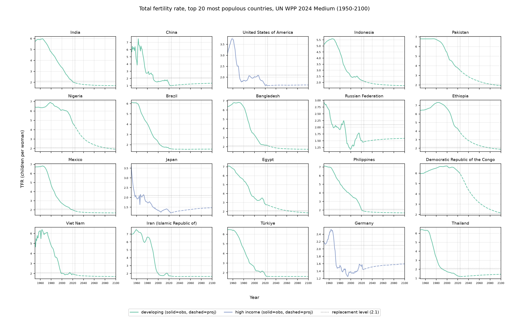

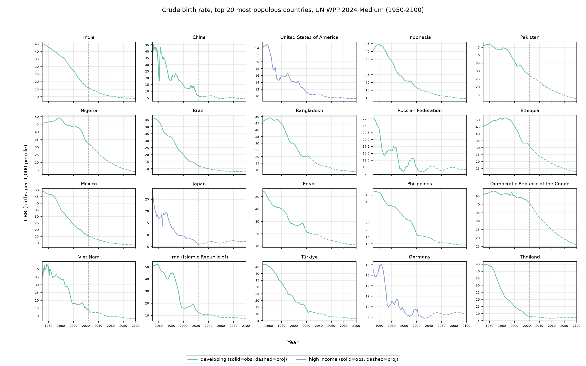

The top 20 most populous countries (2024, from `top20_by_population_2024.csv`) plotted as individual TFR (children per woman) and CBR (births per 1,000) trajectories from UN WPP 2024 Medium — observed series solid (1950–2024), projections dashed (2025–2100), with the 2.1 replacement line on TFR panels and countries colored by income classification (green = developing, blue = high income). Three patterns stand out:

- **Below-replacement today, divergence tomorrow.** China (TFR 1.00 in 2023), Korea-class economies, Thailand (1.21), and Iran (1.70) are already deep below 2.1, while Pakistan (3.61), Nigeria (4.48), Ethiopia (3.99), and DR Congo (6.05) remain decades from the crossing — the same country-level split documented in section 11, now visible as continuous curves rather than snapshot values.
- **CBR shows the lag behind TFR.** Because crude birth rates also depend on age structure, CBR curves fall later and more slowly than TFR curves in the same country: India's TFR hit 2.1 in the 2010s but its CBR stays near 16 because its prime-age cohorts are still huge; conversely China's CBR has already collapsed below 6 per 1,000.
- **The projection geometry.** Developing countries show gently declining dashed tails (even Nigeria's TFR reaches ~1.9 by 2100), while high-income panels show dashed lines that have been flat or rising — driven by migration-inflated populations (US, Canada) and post-crisis fertility recovery assumptions (Germany, Japan).

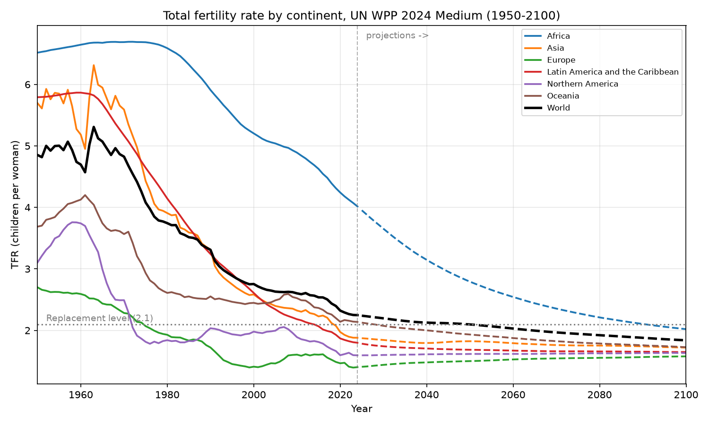

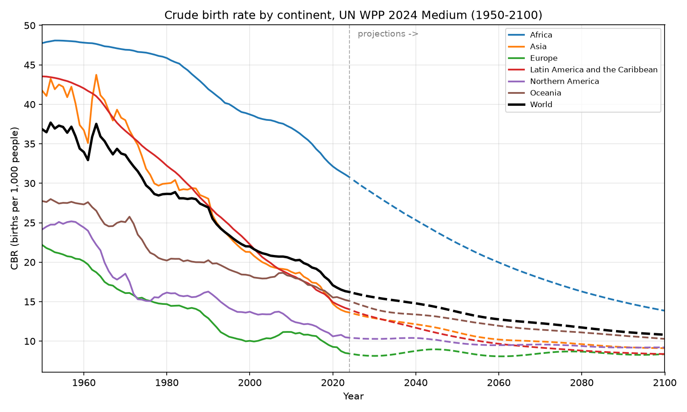

At the continental scale (`continent_tfr_cbr_1950_2100.csv`), the world line (black) is a weighted average of six regions that barely resemble each other:

| Region | TFR 1950 | TFR 2024 | TFR 2100 | CBR 1950 | CBR 2024 | CBR 2100 |
|--------|---------:|---------:|---------:|---------:|---------:|---------:|
| Africa | 6.53 | 4.02 | 2.45 | 47 | 32.6 | 15.7 |
| Asia | 5.79 | 1.86 | 1.55 | 43 | 13.9 | 8.8 |
| Europe | 2.64 | 1.40 | 1.60 | 20 | 8.6 | 8.3 |
| Latin America & Caribbean | 5.86 | 1.78 | 1.61 | 42 | 13.5 | 9.8 |
| Northern America | 3.32 | 1.60 | 1.59 | 24 | 10.6 | 9.7 |
| Oceania | 3.88 | 1.99 | 1.81 | 28 | 14.6 | 11.6 |
| **World** | **4.85** | **2.25** | **1.84** | **36.8** | **16.2** | **10.4** |

Asia has already been below replacement for decades (1.86 today), Europe's projected TFR *rises* modestly as low-fertility assumptions ease, and Africa — the only region still above 2.5 in 2100 — drives the entire global decline trajectory. The world CBR halves twice over the century, 36.8 → 16.2 → 10.4, with Africa's 15.7 in 2100 sitting near where the world as a whole stood in 2020.

### Data processing notes

New processed datasets (`data/processed/`): `country_tfr_cbr_1950_2100.csv` (237 countries × 151 years, 35,787 rows), `continent_tfr_cbr_1950_2100.csv` (7 regions, 1,057 rows), and `top20_tfr_cbr_filled_1950_2100.csv` (top 20 × 151 years, 3,020 rows), each with `tfr`, `cbr`, and an `is_projected` flag (True from 2025). Both indicator columns come natively from the WPP2024 Demographic Indicators Medium file — no aggregation or computation needed. For the top-20 file, observed-year values from OWID (TFR, 74 years of coverage per country) and the World Bank (CBR, 65 years) were woven into the WPP backbone where available; **no interpolation or filling was ultimately required** (`fill_log.csv` is empty, 0 rows) because WPP coverage is complete for all 151 years in every top-20 country. Gotchas handled: the WPP file contains an all-NaN placeholder row for year 2101 per entity (filtered out), and sanity checks confirmed alignment (India 2023 TFR 1.975, China 1.00, world CBR 2024 = 16.2, Africa 2024 TFR = 4.02).

---

## 13. Limitations and gaps

- The Worldometers Kaggle projection extends past UN Medium to 10.87B in 2100; it is a secondary web-tracker lineage and was used only as a divergence illustration, not as an analytical basis.
- Survey-based TFR (UN WFD 2019) covers developing countries: the US and most high-income OECD countries have no survey rows. Estimates also carry source heterogeneity — each point is tagged with its underlying survey.
- WPP age-group data for the World aggregate (LocID 900) is complete only for 2024–2100 in the Medium single-age file; the historical world age chart therefore starts at 2024.
- CIA Factbook birth rates are analyst estimates, not direct vital-registration counts; small countries (e.g., Saint Pierre and Miquelon) carry wide uncertainty.
- All projection statements are scenario-conditional: "the UN projects X" means "under the Medium variant," not a prediction.

---

## 14. Reproducibility

- Raw data: `data/raw/` (WPP2024 gzipped CSVs, OWID CSVs, World Bank zip, Gapminder datapoints, CIA dataset, plus `data/raw/kaggle/` — world-population-19512020, census/population-time-series-data, ivanchvez/fertility)
- Processing script: pandas pipeline (see session scripts) → tidy CSVs in `data/processed/` (26 tidy CSVs incl. 4 Kaggle-derived, 8 country/continent-future datasets, and 4 TFR/CBR trajectory datasets from the WPP2024 Medium file)
- Charts: matplotlib, 150 dpi PNGs in `charts/` (19 PNGs incl. 08a/08b/08c, the country-future charts 09–13, and the TFR/CBR charts 14–17)
- Key data gotchas documented during processing: WPP `PopTotal` is in **thousands**; region `LocID`s differ from common assumptions (Africa=903, **Asia=935**, LAC=904, Northern America=905, Europe=908, Oceania=909); pandas `groupby` drops NaN-key World rows unless `dropna=False`; Worldometers numbers use Indian comma format (`7,79,47,98,739`) — commas stripped, not parsed as separators; UN WFD `Date - Year` holds fractional years (e.g. 1964.977) — floor to int, never parse as a Timestamp; when loading WPP files with `usecols`, pandas returns columns in **file order, not `usecols` order** — never rename positionally, always use `rename(columns={...})` by name (a positional rename silently misaligned the demographic-indicator columns before it was caught); the WPP Demographic Indicators file carries an **all-NaN placeholder row for year 2101** per entity — filter `Time <= 2100` or every series ends with a NaN tail.

### Primary sources
- United Nations, *World Population Prospects 2024* — incl. `WPP2024_Demographic_Indicators_Medium.csv.gz` (Medium variant, annual 1950–2100, the source for sections 9–11)
- Our World in Data (fertility, birth rate, population-with-projections graphs)
- World Bank indicator `SP.DYN.CBRT.IN`
- Gapminder (crude birth rate, births, teen fertility, population datapoints)
- CIA World Factbook (birth rate estimates, 1990–2025)
- Kaggle: sandhyakrishnan02/world-population-19512020 (Worldometers, CC0-1.0); census/population-time-series-data (US POP/POPH); ivanchvez/fertility (UN World Fertility Dataset 2019, CC0-1.0)
- IHME *Lancet* 2024 global fertility forecast; UN *World Fertility and Family Planning 2024*; PRB 2024 World Population Data Sheet (narrative references)
